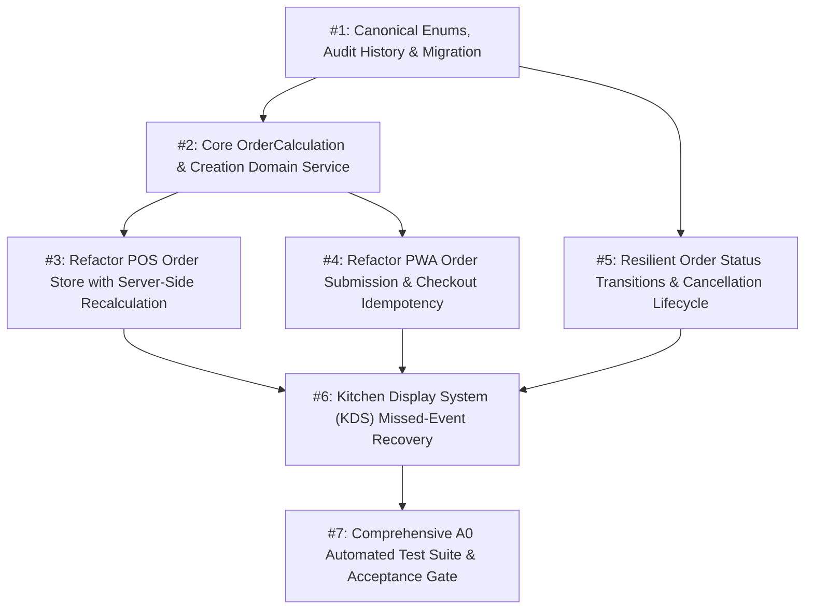

# Stage A0 GitHub Issues: Stabilize Order-to-Kitchen Reliability

This document tracks the small, dependency-aware GitHub issues for **A0: Stabilize order-to-kitchen reliability** ([RESTAURANT_OS_ROADMAP.md](file:///f:/ai/Whatsapp-Order-bot/docs/product/RESTAURANT_OS_ROADMAP.md#L11-L26)).

---

## Issue #1: Canonical Enums, Order Status Audit History & Migration
- **Milestone:** Stage A0 — Order-to-Kitchen Reliability
- **Type:** `architecture`, `database`
- **Dependencies:** None (Foundation)
- **Labels:** `area:orders`, `p0`

### Problem
The `orders` table and codebase have conflicting status and type conventions:
- Statuses in migration are `'Pending', 'Preparing', 'Ready', 'Delivered'` (PascalCase), while PWA routes expect lowercase or different values.
- `order_type` is overloaded (`'WhatsApp'` vs `'POS'`), while `type` is used for fulfillment (`'delivery', 'takeaway', 'dinein'`) and `source` is used ad-hoc.
- There is no actor or timestamp audit trail when an order transitions between statuses.

### Scope & Deliverables
1. **PHP Enums** in `Modules/Orders/app/Enums/`:
   - `OrderStatus`: `Pending`, `Confirmed`, `Preparing`, `Ready`, `OutForDelivery`, `Delivered`, `Cancelled`.
   - `FulfillmentType`: `Delivery`, `Takeaway`, `DineIn`.
   - `OrderSource`: `Pwa`, `Pos`, `WhatsAppBot`, `PhoneManual`.
2. **Database Migration**:
   - Update `orders` columns: `status` (default `Pending`), `fulfillment_type` (replaces ambiguous `type`), `source` (replaces ambiguous `order_type`), and `cancellation_reason` (nullable text).
   - Create `order_status_histories` table: `id`, `tenant_id`, `order_id`, `from_status`, `to_status`, `actor_type` (`staff`, `customer`, `system`), `actor_id` (nullable), `notes` (nullable), `created_at`.
3. **Model Relation**:
   - Add `statusHistories()` relationship and cast enums on [Order.php](file:///f:/ai/Whatsapp-Order-bot/Modules/Orders/app/Models/Order.php).

### Acceptance Criteria
- [ ] Enums defined with strict types and display labels.
- [ ] Backward-compatible migration runs cleanly on PostgreSQL and SQLite (`php artisan migrate`).
- [ ] Existing orders retain valid status mappings without data corruption.

---

## Issue #2: Core OrderCreationService & Server-Side Price Calculation
- **Milestone:** Stage A0 — Order-to-Kitchen Reliability
- **Type:** `backend`, `security`
- **Dependencies:** Issue #1
- **Labels:** `area:orders`, `area:security`, `p0`

### Problem
Order creation logic is duplicated between [PwaController.php](file:///f:/ai/Whatsapp-Order-bot/app/Http/Controllers/Pwa/PwaController.php) and [OrdersController.php](file:///f:/ai/Whatsapp-Order-bot/Modules/Orders/app/Http/Controllers/OrdersController.php). POS trusts client-sent `total_amount` without verifying item prices against the database, opening a severe vulnerability where modified client payloads can forge prices.

### Scope & Deliverables
1. **Service Class**: `app/Services/Orders/OrderCreationService.php`:
   - Encapsulate tenant-isolated order creation in an atomic `DB::transaction()`.
   - Re-fetch each referenced `Product` by ID scoped to current `tenant_id`. Validate active status and tenant ownership.
   - Recalculate item subtotal and order gross total server-side; reject or override client-submitted price totals.
   - Calculate delivery charges based on tenant ordering configuration (free delivery threshold, min order amount).
   - Upsert `Customer` record, increment customer LTV (`total_orders`, `total_spent`), and record delivery address.
   - Log the initial status history entry (`Pending`, actor: creator).
   - Return a structured DTO/Result object containing the persisted `Order`.

### Acceptance Criteria
- [ ] Submitting arbitrary/zero `total_amount` from client has zero effect; order persists with accurate server-computed totals.
- [ ] Cross-tenant product references throw `ModelNotFoundException` or 422 error.
- [ ] If item creation fails midway, database transaction rolls back completely (no orphan `Order` records).

---

## Issue #3: Refactor POS Store Endpoint to Use OrderCreationService
- **Milestone:** Stage A0 — Order-to-Kitchen Reliability
- **Type:** `refactoring`, `pos`
- **Dependencies:** Issue #2
- **Labels:** `area:pos`, `area:orders`, `p0`

### Problem
[OrdersController@store](file:///f:/ai/Whatsapp-Order-bot/Modules/Orders/app/Http/Controllers/OrdersController.php#L76-L129) directly executes unsecured inline model writes, lacks transaction safety, writes raw string statuses, and does not validate product availability.

### Scope & Deliverables
1. **Form Request**: Create `Modules/Orders/app/Http/Requests/StorePosOrderRequest.php`:
   - Validate items array, product IDs, positive quantities, optional customer phone/name, and fulfillment type (`dine_in`, `takeaway`, `delivery`).
2. **Controller Refactoring**:
   - Update `OrdersController@store` to call `OrderCreationService::createFromPos($request->validated())`.
   - Update POS redirect response to return standardized Inertia flash payload with newly generated `order_number`.
3. **Frontend Sync**:
   - Verify [Pos.jsx](file:///f:/ai/Whatsapp-Order-bot/resources/js/Pages/Orders/Pos.jsx) / [Create.jsx](file:///f:/ai/Whatsapp-Order-bot/resources/js/Pages/Orders/Create.jsx) handles validation errors cleanly without clearing cart state.

### Acceptance Criteria
- [ ] POS order submission persists atomically via `OrderCreationService`.
- [ ] Invalid quantities (0 or negative) or inactive product IDs return 422 error messages.
- [ ] Existing POS order placement UI completes successfully and triggers receipt print option.

---

## Issue #4: Refactor PWA Order Submission & Add Checkout Idempotency
- **Milestone:** Stage A0 — Order-to-Kitchen Reliability
- **Type:** `backend`, `pwa`, `resilience`
- **Dependencies:** Issue #2
- **Labels:** `area:pwa`, `resilience`, `p0`

### Problem
Network stutter or double-clicking "Place Order" in the PWA can cause duplicate submissions. Additionally, `PwaController@submitOrder` has inline logic that should delegate to `OrderCreationService`.

### Scope & Deliverables
1. **Idempotency Protection**:
   - Require/generate an `idempotency_key` (UUID) from the PWA checkout client.
   - Cache idempotency key using Redis/Cache tag with a 60-second TTL. If identical key is received within TTL, return the cached successful response without re-executing order creation.
2. **Refactor PwaController**:
   - Delegate order calculation and storage in `PwaController@submitOrder` to `OrderCreationService::createFromPwa(...)`.
   - Maintain existing JSON contract (`success`, `order_number`, `redirect_url`).
3. **PWA Frontend Update**:
   - Disable submission button immediately upon click in [Checkout.jsx](file:///f:/ai/Whatsapp-Order-bot/resources/js/Pages/Pwa/Checkout.jsx) and attach client UUID idempotency key to payload.

### Acceptance Criteria
- [ ] Rapid double-click on PWA checkout results in exactly one database order and one customer receipt.
- [ ] Replaying the exact network payload within 60s returns the existing order confirmation without duplicating database records.

---

## Issue #5: Resilient Order Status Transitions & Cancellation Lifecycle
- **Milestone:** Stage A0 — Order-to-Kitchen Reliability
- **Type:** `backend`, `lifecycle`
- **Dependencies:** Issue #1, Issue #2
- **Labels:** `area:orders`, `p0`

### Problem
Status transitions (`Pending` &rarr; `Preparing` &rarr; `Ready` &rarr; `Delivered`) happen via ad-hoc updates without enforcing valid state machine transitions. Cancelling an order has no dedicated endpoint, does not capture reasons, and does not notify the customer or release kitchen display tickets.

### Scope & Deliverables
1. **Transition Guard**:
   - Create `app/Services/Orders/OrderStatusTransitionService.php`.
   - Enforce valid transitions:
     - `Pending` &rarr; `Preparing` or `Cancelled`
     - `Preparing` &rarr; `Ready` or `Cancelled`
     - `Ready` &rarr; `OutForDelivery` or `Delivered` or `Cancelled`
     - `OutForDelivery` &rarr; `Delivered` or `Cancelled`
     - Terminal states: `Delivered`, `Cancelled` (immutable)
2. **Cancellation Handler**:
   - Add `POST /orders/{order}/cancel` with `cancellation_reason` validation.
   - Record transition in `order_status_histories`.
3. **Notification Safety**:
   - Fire `OrderStatusUpdated` event wrapped in queue worker. If WhatsApp notification fails, the order status update itself must not rollback.

### Acceptance Criteria
- [ ] Attempting an invalid transition (e.g. `Delivered` &rarr; `Preparing`) throws an `InvalidOrderTransitionException` (422).
- [ ] Cancelling an order captures actor ID and reason, logs history, and broadcasts status update.
- [ ] WhatsApp notification dispatch failures are logged without blocking or rolling back status changes.

---

## Issue #6: KDS Missed-Event Recovery & Polling Fallback
- **Milestone:** Stage A0 — Order-to-Kitchen Reliability
- **Type:** `frontend`, `kds`, `realtime`
- **Dependencies:** Issue #1, Issue #5
- **Labels:** `area:kds`, `area:frontend`, `p0`

#### Problem
If a kitchen tablet goes to sleep, switches Wi-Fi networks, or drops WebSocket connection, orders placed during the disconnect are missed until a manual page refresh.

### Scope & Deliverables
1. **Window Focus & Online Recovery**:
   - In [UnifiedKds.jsx](file:///f:/ai/Whatsapp-Order-bot/resources/js/Pages/Orders/UnifiedKds.jsx), attach listeners for `window.addEventListener('online')` and `document.addEventListener('visibilitychange')`.
   - Trigger an immediate router reload (`only: ['orders']`) whenever the browser tab regains focus or reconnects.
2. **Heartbeat / Connection Indicator**:
   - Display a small live status badge on the KDS top bar: "Live (WebSocket)" (green) vs "Syncing (Polling fallback)" (amber).
   - If Echo reports `pusher:subscription_error` or disconnect, seamlessly fall back to a 5-second background reload without interrupting active kitchen staff interactions.
3. **Unified Display**:
   - Render order items with their proper fulfillment type tags (`Delivery`, `Takeaway`, `Dine-In`) and canonical status styling.

### Acceptance Criteria
- [ ] Disconnecting and reconnecting Wi-Fi on a KDS client automatically re-synchronizes all pending orders within 5 seconds without manual page reload.
- [ ] Visual indicator shows WebSocket vs Polling connection state clearly to kitchen staff.

---

## Issue #7: Comprehensive A0 Automated Test Suite & Acceptance Gate
- **Milestone:** Stage A0 — Order-to-Kitchen Reliability
- **Type:** `testing`, `qa`
- **Dependencies:** Issues #1, #2, #3, #4, #5, #6
- **Labels:** `testing`, `gate`, `p0`

### Problem
To satisfy the A0 Acceptance Gate in `RESTAURANT_OS_ROADMAP.md`, we must prove through automated tests that every valid order is priced correctly, stored once, visible to the kitchen, and resilient to duplicates or failures.

### Scope & Deliverables
1. **Feature Test Suite** (`tests/Feature/Orders/`):
   - `OrderPricingIntegrityTest.php`: Submit tampered prices from client; assert database stores catalog-computed prices.
   - `TenantIsolationOrderTest.php`: Attempt to create an order referencing another tenant's products; assert 422 / 404 forbidden.
   - `OrderFulfillmentLifecycleTest.php`: Walk an order through all valid status transitions and assert audit history records. Assert invalid transitions fail.
   - `OrderCheckoutIdempotencyTest.php`: Concurrently submit identical idempotency keys; assert exactly 1 order created.
   - `KdsOrderFeedEndpointTest.php`: Verify tenant-scoped KDS query returns active pending/preparing/ready orders.
2. **Pest Verification**:
   - Execute `php artisan test --compact --filter=Order`.

### Acceptance Criteria
- [ ] All new tests pass with 100% success rate under `php artisan test --compact`.
- [ ] Zero code style regressions (`vendor/bin/pint --format agent` runs clean).
- [ ] A0 Acceptance Gate criteria in `RESTAURANT_OS_ROADMAP.md` is met and verifiable in CI.
