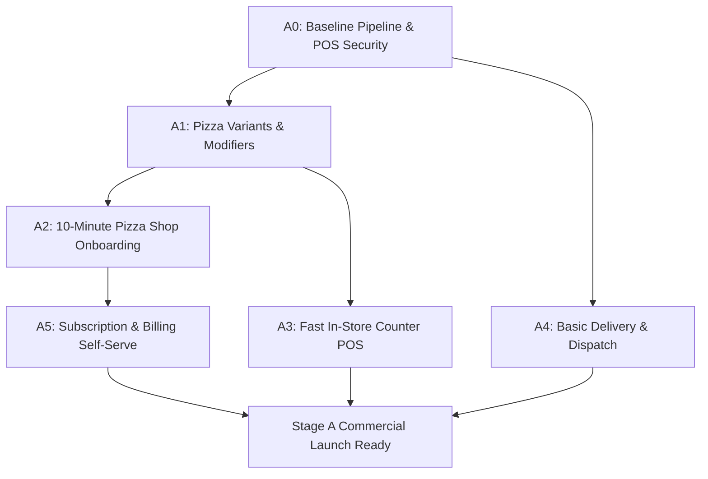

# OrmEasy Restaurant OS: Implementation vs. Roadmap Execution Plan

## 1. Executive Summary & Strategic Guardrails

### 1.1 Objective
Transform the existing OrmEasy repository into a commercially viable, sellable, and retaining SaaS product for **small pizza shops, burger joints, and cloud kitchens** (Stage A), before expanding into complex multi-station, full-service restaurant operations (Stage B & Stage C).

### 1.2 Core Architectural Principles
1. **Reuse Before Rebuilding**: Every feature builds directly upon existing modules (`Modules/Orders`, `Modules/Menu`, `Modules/Bot`, `Modules/Crm`, `Modules/Pwa`, `app/Services`).
2. **Zero Architecture Rewrite**: No switching frameworks, ripping out Inertia/React, changing multi-tenancy models, or breaking working endpoints.
3. **PWA as Canonical Order Intake Engine**: Pizza customizations (crust, size, extra toppings) must be natively configured in `Modules/Menu`, selected in `Modules/Pwa`, invoiced via `Modules/Orders`, and broadcast to KDS without bespoke forks.
4. **Commercial Readiness First**: Prioritize what small pizza shops actually pay for: order accuracy, reliable WhatsApp confirmation, instantaneous KDS alerting, and frictionless customer ordering.

---

## 2. Codebase Baseline & Asset Inventory

| Domain / Subsystem | Existing Files & Components | Current Capabilities | Reusability Grade |
| :--- | :--- | :--- | :--- |
| **Catalog & Menu** | [Category.php](file:///f:/ai/Whatsapp-Order-bot/Modules/Menu/app/Models/Category.php) [Product.php](file:///f:/ai/Whatsapp-Order-bot/Modules/Menu/app/Models/Product.php) [Deal.php](file:///f:/ai/Whatsapp-Order-bot/Modules/Menu/app/Models/Deal.php) [DealItem.php](file:///f:/ai/Whatsapp-Order-bot/Modules/Menu/app/Models/DealItem.php) [MenuController.php](file:///f:/ai/Whatsapp-Order-bot/Modules/Menu/app/Http/Controllers/MenuController.php) | Categories, products, basic deals, price/image/status flags. | **High (Extendable)**: Add variants (sizes) and modifier groups (crust, toppings) without altering base product table schema assumptions. |
| **PWA Online Ordering** | [PwaController.php](file:///f:/ai/Whatsapp-Order-bot/app/Http/Controllers/Pwa/PwaController.php) [Menu.jsx](file:///f:/ai/Whatsapp-Order-bot/resources/js/Pages/Pwa/Menu.jsx) [Checkout.jsx](file:///f:/ai/Whatsapp-Order-bot/resources/js/Pages/Pwa/Checkout.jsx) [CartContext.jsx](file:///f:/ai/Whatsapp-Order-bot/resources/js/Contexts/CartContext.jsx) | Server-side pricing verification, CRM customer upsert, minimum delivery check, transaction-safe order writing. | **High**: Add modal dialog for pizza size & toppings selection; feed structured items to `submitOrder`. |
| **Order Processing & POS** | [OrdersController.php](file:///f:/ai/Whatsapp-Order-bot/Modules/Orders/app/Http/Controllers/OrdersController.php) [Order.php](file:///f:/ai/Whatsapp-Order-bot/Modules/Orders/app/Models/Order.php) [OrderItem.php](file:///f:/ai/Whatsapp-Order-bot/Modules/Orders/app/Models/OrderItem.php) [Create.jsx](file:///f:/ai/Whatsapp-Order-bot/resources/js/Pages/Orders/Create.jsx) | POS order creation, listing, status transitions, receipt printing helper. | **Medium**: POS creation must adopt server-side pricing validation and database transactions currently present in PWA. |
| **KDS (Kitchen Display)** | [OrdersController.php](file:///f:/ai/Whatsapp-Order-bot/Modules/Orders/app/Http/Controllers/OrdersController.php) (`unifiedKds`) [UnifiedKds.jsx](file:///f:/ai/Whatsapp-Order-bot/resources/js/Pages/Orders/UnifiedKds.jsx) [OrderStatusUpdated.php](file:///f:/ai/Whatsapp-Order-bot/app/Events/OrderStatusUpdated.php) | Real-time WebSocket order card updates, audible alert chime, preparation timer, status progression. | **High**: Fully functional; needs fallback polling/refetching if WebSocket drops, plus modifiers display on item cards. |
| **Customer & CRM** | [Customer.php](file:///f:/ai/Whatsapp-Order-bot/Modules/Crm/app/Models/Customer.php) [CustomerController.php](file:///f:/ai/Whatsapp-Order-bot/Modules/Crm/app/Http/Controllers/CustomerController.php) | Customer auto-discovery from phone number, order history, tags, total spend aggregation. | **High**: Excellent; ready to power repeat customer recognition at POS and in WhatsApp bot. |
| **WhatsApp Automation** | [EvolutionApiService.php](file:///f:/ai/Whatsapp-Order-bot/app/Services/EvolutionApiService.php) [WebhookController.php](file:///f:/ai/Whatsapp-Order-bot/Modules/Bot/app/Http/Controllers/WebhookController.php) [SendOrderReceiptJob.php](file:///f:/ai/Whatsapp-Order-bot/app/Jobs/SendOrderReceiptJob.php) | Evolution API v2 connection, automated receipt sending, incoming message parsing. | **High**: Stabilize outgoing delivery templates and status update pings. |
| **Onboarding & Multi-Tenant** | [MerchantOnboardingService.php](file:///f:/ai/Whatsapp-Order-bot/app/Services/MerchantOnboardingService.php) [TenantCapabilityService.php](file:///f:/ai/Whatsapp-Order-bot/app/Services/TenantCapabilityService.php) [MerchantRoiService.php](file:///f:/ai/Whatsapp-Order-bot/app/Services/MerchantRoiService.php) | Quick tenant creation, default category seeding, feature gating by tier. | **High**: Ready to power the 10-minute onboarding wizard and self-serve trial setup. |

---

## 3. Implementation Plan: Stage A (Small Pizza Shop Commercial Readiness)

### Stream A0: Order Pipeline Harmonization & Integrity (P0)

#### 1. Objectives & Context
Currently, `PwaController@submitOrder` runs within a `DB::transaction`, re-verifies prices against the database, validates minimum delivery amounts, and safely creates customer records. In contrast, `OrdersController@store` (POS) trusts client-submitted `total_amount`, does not enforce transactional atomicity, and uses divergent column conventions (`order_type: 'POS'` vs PWA `order_type: 'WhatsApp'`, `type: 'delivery'`). We must standardize order intake into a single unified service.

#### 2. Code to Reuse
- [PwaController.php](file:///f:/ai/Whatsapp-Order-bot/app/Http/Controllers/Pwa/PwaController.php#L65-L162): Server-side recalculation logic, item price resolution, CRM customer upsert.
- [Order.php](file:///f:/ai/Whatsapp-Order-bot/Modules/Orders/app/Models/Order.php): Base Eloquent relationships and scopes (`tenant`, `items`, `customer`).
- [SendOrderReceiptJob.php](file:///f:/ai/Whatsapp-Order-bot/app/Jobs/SendOrderReceiptJob.php): Async WhatsApp confirmation dispatcher.

#### 3. Unfinished Work & Files to Create / Modify
- **Create Order Creation Service**: `app/Services/OrderCreationService.php` to encapsulate order calculation, item snapshots, tax/delivery calculation, customer upsert, and event dispatching.
- **Refactor Controllers**:
  - Update [OrdersController.php](file:///f:/ai/Whatsapp-Order-bot/Modules/Orders/app/Http/Controllers/OrdersController.php#L72-L115) to delegate POS submissions to `OrderCreationService`.
  - Update [PwaController.php](file:///f:/ai/Whatsapp-Order-bot/app/Http/Controllers/Pwa/PwaController.php#L65-L162) to delegate online store submissions to `OrderCreationService`.
- **Harmonize Schema & Enums**: Ensure canonical values for:
  - `source`: `pwa`, `pos`, `whatsapp_bot`, `phone_manual`.
  - `fulfillment_type`: `delivery`, `takeaway`, `dine_in`.
  - `status`: `pending`, `confirmed`, `preparing`, `ready`, `out_for_delivery`, `completed`, `cancelled`.

#### 4. Implementation Issues & Edge Cases
- Concurrent order submissions locking inventory or sequence counter: Use `DB::transaction` with retry.
- WhatsApp message failures must not fail order creation: Jobs must remain queued and failure-isolated.

#### 5. Automated Test Requirements
- `tests/Feature/OrderCreationServiceTest.php`:
  - Test server-side price enforcement (client submits manipulated lower price; system overrides with DB price).
  - Test atomic rollback on item creation failure.
  - Test CRM customer upsert and order history association.

---

### Stream A1: Pizza Catalog — Variants & Modifiers (P0)

#### 1. Objectives & Context
Small pizza operations require multi-size pricing (e.g. 7" Personal, 10" Medium, 13" Large), crust selection (Thin, Pan, Stuffed), and extra toppings/modifiers (Cheese, Jalapeno, Pepperoni). Currently, `Product` has only a single scalar `price` column.

#### 2. Code to Reuse
- [Product.php](file:///f:/ai/Whatsapp-Order-bot/Modules/Menu/app/Models/Product.php): Add `hasMany(ProductVariant::class)` and `belongsToMany(ModifierGroup::class)`.
- [Category.php](file:///f:/ai/Whatsapp-Order-bot/Modules/Menu/app/Models/Category.php): Organization and display sequencing.
- [OrderItem.php](file:///f:/ai/Whatsapp-Order-bot/Modules/Orders/app/Models/OrderItem.php): Already has `options` JSON field for storing selected modifiers snapshot.

#### 3. Unfinished Work & Files to Create / Modify
- **Database Migrations** in `Modules/Menu/database/migrations/`:
  - `create_product_variants_table`: `product_id`, `name` (Small, Medium, Large), `price`, `sku`, `is_default`, `is_active`.
  - `create_modifier_groups_table`: `tenant_id`, `name` (Crust, Extra Toppings), `min_selections`, `max_selections`, `is_required`.
  - `create_modifier_options_table`: `modifier_group_id`, `name`, `price`, `is_active`.
  - `create_product_modifier_group_table`: Pivot table linking products to modifier groups.
- **Models**:
  - `Modules/Menu/app/Models/ProductVariant.php`
  - `Modules/Menu/app/Models/ModifierGroup.php`
  - `Modules/Menu/app/Models/ModifierOption.php`
- **PWA UI Extension**:
  - Create `resources/js/Components/Pwa/ProductOptionModal.jsx` for selecting size, crust, and add-ons before adding to cart.
  - Update `CartContext.jsx` to hash cart items by `product_id + variant_id + sorted_modifier_ids` so identical items with different toppings stay separate.
- **KDS & Receipt Display**:
  - Render variants and modifiers clearly under the product name in [UnifiedKds.jsx](file:///f:/ai/Whatsapp-Order-bot/resources/js/Pages/Orders/UnifiedKds.jsx) and thermal receipt printouts.

#### 4. Implementation Issues & Edge Cases
- Price snapshot integrity: If a pizza topping price changes tomorrow, historical orders must preserve the price paid at checkout time via `OrderItem` JSON snapshot.
- Zero-modifier fallback: Simple products (e.g. Cans of Soda) must continue working seamlessly without requiring variant or modifier setup.

#### 5. Automated Test Requirements
- `tests/Feature/PizzaCatalogTest.php`:
  - Test product creation with 3 variants and 2 modifier groups.
  - Test order checkout pricing calculation with base size + crust upgrade + 2 paid toppings.

---

### Stream A2: 10-Minute Pizza Shop Onboarding Wizard (P0)

#### 1. Objectives & Context
Fulfill the commercial promise in `PRODUCT_DECISIONS.md`: A non-technical pizza shop owner must go from sign-up to taking live test orders in under 10 minutes.

#### 2. Code to Reuse
- [MerchantOnboardingService.php](file:///f:/ai/Whatsapp-Order-bot/app/Services/MerchantOnboardingService.php): Already handles tenant initialization, workspace setup, and starter category provisioning.
- [TenantCapabilityService.php](file:///f:/ai/Whatsapp-Order-bot/app/Services/TenantCapabilityService.php): Feature toggling by plan.

#### 3. Unfinished Work & Files to Create / Modify
- **Seeder / Preset Catalog**:
  - Add `database/seeders/presets/PizzaShopStarterSeeder.php` containing standard starter items (Margherita, Pepperoni, BBQ Chicken, Garlic Bread, Soft Drinks) with standard variants (Small, Medium, Large) and common crust/topping groups.
- **Onboarding UI Wizard**:
  - Create `resources/js/Pages/Onboarding/Wizard.jsx`:
    - Step 1: Restaurant Name, Currency, Phone Number, Logo upload.
    - Step 2: One-click "Load Pizza Template Menu" or custom menu.
    - Step 3: Delivery Zones & Fees (Fixed fee vs distance).
    - Step 4: WhatsApp Connection QR scan or preview link.
- **Dashboard Progress Checklist**:
  - Add a lightweight "Get Ready to Sell" banner on `Dashboard.jsx` checking off: (1) Menu configured, (2) WhatsApp linked, (3) Test order placed, (4) First print tested.

#### 4. Automated Test Requirements
- `tests/Feature/MerchantOnboardingWizardTest.php`:
  - Test that selecting "Pizza Shop" template seeds categories, products, variants, and modifiers correctly in under 2 seconds.

---

### Stream A3: Fast In-Store Counter POS (P1)

#### 1. Objectives & Context
Counter staff at small pizza shops receive walk-ins and phone calls. They require a fast touch-screen ordering interface with rapid item search, size/modifier popups, instant customer search by phone number, and thermal receipt printing.

#### 2. Code to Reuse
- [Create.jsx](file:///f:/ai/Whatsapp-Order-bot/resources/js/Pages/Orders/Create.jsx): Existing POS item picker and summary view.
- [OrdersController.php](file:///f:/ai/Whatsapp-Order-bot/Modules/Orders/app/Http/Controllers/OrdersController.php): `create` method passing categories and products.
- [CustomerController.php](file:///f:/ai/Whatsapp-Order-bot/Modules/Crm/app/Http/Controllers/CustomerController.php): Phone number lookup endpoint.

#### 3. Unfinished Work & Files to Create / Modify
- **UI Enhancements in `Create.jsx`**:
  - Add quick category filter tabs (Pizzas, Sides, Beverages, Deals).
  - Add product variant/modifier modal identical to PWA logic.
  - Implement real-time phone number auto-complete matching `Customer` records in `Modules/Crm`.
  - Cash calculator modal with "Quick Cash" buttons ($10, $20, $50, Exact) and change return calculation.
- **Thermal Receipt Optimization**:
  - Standardize 80mm/58mm raw ESC/POS and browser print stylesheet in `resources/js/Components/ReceiptPrinter.jsx`.

#### 4. Automated Test Requirements
- `tests/Feature/PosCounterOrderTest.php`:
  - Test POS order placement with cash payment, change calculation, and inventory/receipt snapshotting.

---

### Stream A4: Basic Delivery & Dispatch Queue (P1)

#### 1. Objectives & Context
Pizza shops live on delivery. They do not need complex GPS driver tracking on day 1, but they do need an organized dispatch queue: orders ready for delivery, assigned to an in-house driver, marked dispatched, and completed upon cash return.

#### 2. Code to Reuse
- [Order.php](file:///f:/ai/Whatsapp-Order-bot/Modules/Orders/app/Models/Order.php): Scopes for `ready`, `out_for_delivery`.
- [UnifiedKds.jsx](file:///f:/ai/Whatsapp-Order-bot/resources/js/Pages/Orders/UnifiedKds.jsx): Visual cards with timers.

#### 3. Unfinished Work & Files to Create / Modify
- **Driver Management**:
  - Lightweight driver entity or role in `Modules/Orders/app/Models/DeliveryDriver.php` (Name, Phone, Active status).
- **Dispatch Board**:
  - Create `resources/js/Pages/Orders/Dispatch.jsx`:
    - Column 1: Awaiting Driver (Status `ready`).
    - Column 2: On the Road (Status `out_for_delivery`, assigned driver name, trip duration timer).
    - Column 3: Delivered / Settle Cash.
- **WhatsApp Notification Trigger**:
  - When marked `out_for_delivery`, automatically send WhatsApp message: *"Your order is on the way with [Driver Name]!"*.

#### 4. Automated Test Requirements
- `tests/Feature/DeliveryDispatchTest.php`:
  - Test driver assignment and state transition from `ready` -> `out_for_delivery` -> `completed`.

---

### Stream A5: Commercial Billing & Multi-Tenant Self-Serve (P1)

#### 1. Objectives & Context
To sell the product, we need automated tenant subscription handling, free trial countdown, and plan tier enforcement without manual database interventions.

#### 2. Code to Reuse
- [TenantCapabilityService.php](file:///f:/ai/Whatsapp-Order-bot/app/Services/TenantCapabilityService.php): Feature checks (`hasFeature('kds')`, `hasFeature('delivery_dispatch')`).
- Multi-tenancy structure in central app.

#### 3. Unfinished Work & Files to Create / Modify
- **Subscription Model & Middleware**:
  - Add subscription status fields to `Tenant` model (`plan_name`, `trial_ends_at`, `subscription_status`).
  - Add `CheckTenantSubscription` middleware to redirect expired accounts to a billing page.
- **Plan Enforcement**:
  - Tier 1: Starter (Single branch, PWA + WhatsApp bot + KDS, up to 300 orders/month).
  - Tier 2: Growth (Unlimited orders, In-store POS, Delivery Dispatch, Multi-user).

#### 4. Automated Test Requirements
- `tests/Feature/TenantSubscriptionEnforcementTest.php`:
  - Test access restriction when trial expires.
  - Test feature accessibility based on plan.

---

## 4. Expansion Plan: Stage B & Stage C (Post-Launch Expansion)

The following stages must not begin implementation until Stage A has active commercial users.

### Stage B: Medium Restaurant & Full Dine-In (Future Expansion)
1. **B1: Visual Table Layout & QR Ordering**:
   - Table map grid editor, dynamic table QR codes linking to PWA table session.
2. **B2: Waiter Mobile POS Handheld**:
   - Optimized mobile view for floor staff to take orders and send directly to kitchen stations.
3. **B3: Multi-Station KDS Routing**:
   - Route pizza items to Pizza Oven KDS, burgers to Grill KDS, and drinks to Bar display.
4. **B4: Integrated Card Payments**:
   - Tap-to-pay and terminal integrations (Stripe Terminal / SumUp / local gateways).

### Stage C: Enterprise Restaurant Operations (Future Expansion)
1. **C1: Raw Ingredient Inventory & Depletion (BOM)**:
   - Deduct dough, cheese, and pepperoni stock based on recipe definitions.
2. **C2: Cash Register Shift & Safe Reconciliation**:
   - Opening float, cash drops, shift closing X/Z reports.
3. **C3: Multi-Branch & Commissary Hub**:
   - Central kitchen dispatching dough and prepped ingredients to satellite branch outlets.

---

## 5. Work Breakdown, Sequencing & Complexity Matrix

| Phase | Task ID | Work Item Description | Files Affected | Complexity | Priority | Dependencies |
| :--- | :--- | :--- | :--- | :--- | :--- | :--- |
| **A0** | A0.1 | Create `OrderCreationService` | `app/Services/OrderCreationService.php` | Medium | **P0** | None |
| **A0** | A0.2 | Refactor POS & PWA Controllers to Service | `OrdersController.php`, `PwaController.php` | Low | **P0** | A0.1 |
| **A0** | A0.3 | Harmonize order status & source enums | `Order.php`, migrations | Low | **P0** | A0.1 |
| **A1** | A1.1 | Migrations for Variants & Modifiers | `Modules/Menu/database/migrations/*` | Medium | **P0** | None |
| **A1** | A1.2 | Variant & Modifier Models & Relations | `ProductVariant.php`, `ModifierGroup.php` | Low | **P0** | A1.1 |
| **A1** | A1.3 | PWA Pizza Customization Modal UI | `ProductOptionModal.jsx`, `CartContext.jsx` | Medium | **P0** | A1.2 |
| **A1** | A1.4 | KDS & Receipt Modifier Display | `UnifiedKds.jsx`, `ReceiptPrinter.jsx` | Low | **P0** | A1.2 |
| **A2** | A2.1 | Pizza Shop Starter Menu Seeder | `PizzaShopStarterSeeder.php` | Low | **P0** | A1.2 |
| **A2** | A2.2 | 10-Minute Onboarding Wizard UI | `Pages/Onboarding/Wizard.jsx` | Medium | **P0** | A2.1 |
| **A3** | A3.1 | Counter POS Variant/Modifier Modal | `Pages/Orders/Create.jsx` | Medium | **P1** | A1.2, A0.1 |
| **A3** | A3.2 | POS Quick Cash & Change Calculator | `Pages/Orders/Create.jsx` | Low | **P1** | A3.1 |
| **A4** | A4.1 | Delivery Driver Model & Dispatch View | `DeliveryDriver.php`, `Dispatch.jsx` | Medium | **P1** | A0.3 |
| **A4** | A4.2 | Out-for-Delivery WhatsApp Notification | `EvolutionApiService.php`, Event Listener | Low | **P1** | A4.1 |
| **A5** | A5.1 | Tenant Subscription Expiry Middleware | `CheckTenantSubscription.php`, `Tenant.php` | Low | **P1** | None |

---

## 6. Execution Verification Protocol
Every stream implementation must satisfy:
1. **Static Analysis & Formatting**: Run `vendor/bin/pint --format agent` on all modified PHP files.
2. **Automated Test Suite**: Run `php artisan test --compact` with 100% pass rate.
3. **No Regressions**: Existing PWA ordering flow and KDS WebSocket events must remain operational.
4. **Browser Verification**: Use DevTools/Playwright to verify UI responsiveness on mobile and tablet resolutions.
