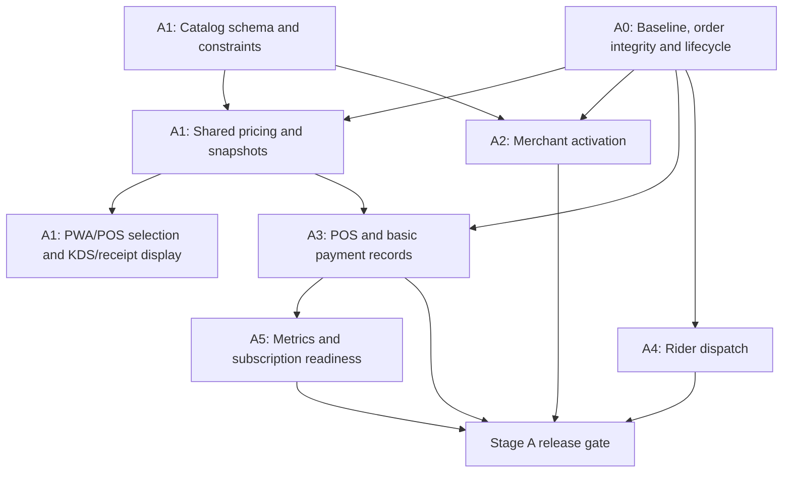

# OrmEasy Restaurant OS — Implementation vs. Roadmap Execution Plan

**Status:** Corrected execution baseline  
**Date:** 2026-11-14  
**Source of truth:** `RESTAURANT_OS_ROADMAP.md`, `RESTAURANT_OS_GAP_ANALYSIS.md`, and `PRODUCT_DECISIONS.md`  
**Purpose:** Translate the agreed product roadmap into an evidence-based, dependency-aware implementation plan. This document is not authorization to start every workstream at once.

---

## 1. Executive direction and guardrails

### 1.1 Commercial objective

**Stage A:** Make OrmEasy commercially useful for small pizza shops, cloud kitchens, takeaway outlets and small restaurants. Optimize for affordable subscriptions, fast activation, dependable order fulfilment and repeat customer ordering.

**Stage B/C:** Expand after Stage A has active merchants and evidence of retention into dine-in, reservations, advanced kitchen operations, inventory and finance.

The ten-minute objective is minimum viable activation: publish a branded PWA, configure a basic menu, connect or deliberately defer WhatsApp where provider setup requires it, and place a successful test order. It is not a promise that every advanced setting can be completed in ten minutes. Measure real onboarding sessions before marketing it as a guarantee.

### 1.2 Non-negotiable engineering rules

1. Reuse the current Laravel, Inertia/React, tenancy, module and service foundations. Do not rewrite the architecture without evidence of a blocking limitation and explicit approval.
2. Keep one authoritative order/pricing domain for PWA, POS and future WhatsApp/phone intake.
3. Never trust client-supplied prices, totals, discounts, tenant IDs or payment state.
4. Enforce tenant ownership and authorization on every read and mutation; UI hiding is not authorization.
5. Preserve historical order and financial records when catalog data changes or is retired.
6. Use database transactions for related writes, idempotency for retried requests, and recoverable event delivery for downstream workflows.
7. Keep restaurant domain boundaries clean. Car rental remains a separate product.
8. A capability flag, route, model, screen, screenshot or test name is not proof of a complete workflow.
9. Do not start Stage B/C implementation until Stage A has active commercial users and the product evidence justifies expansion.
10. Prefer small, reviewable issues and PRs. Do not combine unrelated streams into a large agent-generated change.

---

## 2. Verified repository baseline and corrections

This baseline reflects targeted inspection of the current default branch and selected source files. It is not a full security audit, complete test run, or production-readiness certification. Re-check the current branch before implementation because files may have changed.

| Area | Evidence observed | Accurate status and implication |
|---|---|---|
| Product catalog | `Modules/Menu/app/Models/Product.php` has basic category, name, description, scalar price, image and active fields. No variant/modifier relations were present in the inspected model. | **Partial.** Extend the catalog; do not assume a pizza-grade option engine exists. |
| PWA customization UI | `resources/js/Pages/Pwa/OrderMenu.jsx` already contains a customization drawer with hard-coded variant labels and add-ons. | **Prototype UI only.** Replace hard-coded choices with tenant catalog data and real pricing rules; do not build a duplicate drawer unnecessarily. |
| PWA checkout payload | The inspected PWA page submits product ID and quantity. It does not submit the selected variant/add-ons from the drawer. | **Critical gap.** The current selections do not reach authoritative checkout calculation. |
| PWA order creation | `app/Http/Controllers/Pwa/PwaController.php` uses a database transaction and recalculates using the base product price. It currently silently skips a product if lookup fails, and uses inconsistent order type/source values. | **Partial.** Preserve transaction-based approach, but reject invalid/cross-tenant selections and validate every cart line. |
| Order line schema | `Modules/Orders/database/migrations/2026_07_06_111713_create_order_items_table.php` contains product ID, quantity, unit price and subtotal. No options JSON or immutable descriptive snapshot was present in the inspected migration/model. Product deletion currently cascades to order lines. | **Critical data-model gap.** Add snapshots and change deletion policy so catalog cleanup cannot erase historical sales. |
| POS | `resources/js/Pages/Orders/Pos.jsx` posts the client-calculated total. `Modules/Orders/app/Http/Controllers/OrdersController.php::store` accepts that total, creates the order and lines without one enclosing transaction, and updates CRM spend from the submitted total. | **Unsafe/partial.** POS must use the shared server-side order service and must not own pricing logic. |
| Order model | `Modules/Orders/app/Models/Order.php` has basic fields and item relationship. No ready/out-for-delivery scopes were present in the inspected model. | **Foundation only.** Do not reference unverified scopes; implement query scopes only if they add clear value. |
| Status handling | The inspected controller accepts a small set of title-case statuses and updates status directly. No complete transition matrix or status-history record was established. | **Partial.** Introduce validated transitions and audit history with a safe legacy-data migration. |
| KDS | `resources/js/Pages/Orders/UnifiedKds.jsx` and `app/Events/OrderCreated.php` establish a realtime broadcast foundation. The event uses `ShouldBroadcastNow`. | **Partial.** Realtime broadcast is not durable delivery. Add authoritative reload/recovery and test missed events, reconnects and tenant channel authorization. |
| CRM | `Modules/Crm` contains customer identity/history foundations and PWA checkout upserts customers. | **Reusable shared infrastructure.** Do not duplicate customer identity inside POS or delivery modules. |
| WhatsApp | Evolution/Meta integration paths and notification foundations exist in the repository. | **Integration foundation.** Validate each provider's connection lifecycle, webhook verification, retries, template requirements and tenant binding before declaring activation complete. |
| Onboarding | `MerchantOnboardingService` and tenant capability services exist. | **Foundation.** The end-to-end ten-minute activation outcome is not yet proven by the presence of these services. |
| Payments, delivery, inventory, reservations | Capabilities/foundations may exist, but the inspected evidence does not establish complete merchant workflows. | **Do not mark implemented/verified without end-to-end evidence.** |

### 2.1 File-path corrections for implementation

Use these observed paths as starting points, and re-check the current branch before editing:

- POS UI: `resources/js/Pages/Orders/Pos.jsx` (not `Create.jsx`).
- PWA ordering UI: `resources/js/Pages/Pwa/OrderMenu.jsx`.
- PWA checkout controller: `app/Http/Controllers/Pwa/PwaController.php`.
- POS/order controller: `Modules/Orders/app/Http/Controllers/OrdersController.php`.
- Order models: `Modules/Orders/app/Models/Order.php`, `OrderItem.php`.
- Catalog model: `Modules/Menu/app/Models/Product.php`.
- Order-line migration: `Modules/Orders/database/migrations/2026_07_06_111713_create_order_items_table.php`.

Do not rely on local absolute `file:///...` links in repository documentation. Use repository-relative paths.

---

## 3. Target domain contracts

These contracts should be agreed before implementation. They describe business meaning, not a mandate to introduce a large new abstraction layer.

### 3.1 Canonical order fields

Separate these concepts:

- `source`: where the order entered the system — `pwa`, `pos`, `whatsapp_bot`, `phone_manual` (and future explicitly supported sources).
- `fulfillment_type`: how it is fulfilled — `delivery`, `takeaway`, `dine_in`.
- `status`: the operational lifecycle state.
- `payment_status`: the financial settlement state; it must not be inferred solely from the fulfilment status.

The existing `order_type` and `type` fields have been used inconsistently. Inspect every reader, writer, filter, report, event and test before choosing a migration. Do not blindly rename or rewrite stored values.

Suggested canonical operational states:

- `pending`
- `confirmed`
- `preparing`
- `ready`
- `out_for_delivery` (delivery only)
- `completed`
- `cancelled`

Define allowed transitions explicitly. For example, a takeaway order can move from `ready` to `completed`; a delivery order normally moves from `ready` to `out_for_delivery` and then `completed`. Failed delivery needs an explicit outcome/retry path rather than pretending the order was completed. Cancellation must have an actor, reason and timestamp. Do not allow arbitrary status changes from the browser.

Use a compatibility migration: inventory existing values, backfill canonical fields, update all consumers, retain rollback/reconciliation options, and only remove legacy fields after production data and code compatibility are proven.

### 3.2 Shared order creation and pricing

Create a focused service (suggested starting point: `app/Services/OrderCreationService.php`, subject to the repository's existing service conventions) that coordinates:

1. Resolve tenant context from trusted server-side tenancy, never from a client-supplied tenant identifier.
2. Validate active product, variant, modifier group and modifier option ownership and availability within that tenant.
3. Validate selection constraints: required groups, minimum/maximum counts, included quantities and permitted combinations.
4. Recalculate base price, variant price, modifier deltas, discounts, delivery fee, tax/service charges where configured, and final total on the server.
5. Persist order, order lines and immutable snapshots in one database transaction.
6. Upsert/link the CRM customer without allowing cross-tenant identity leakage.
7. Persist an idempotency key and return the existing result for a legitimate retry.
8. Dispatch downstream events/notifications only after the database transaction commits. Failures in WhatsApp or realtime delivery must not roll back a valid paid/accepted order; they must be logged and recoverable.

The service must not become a giant class that owns subscriptions, rider dispatch, payment gateways and every restaurant workflow. Keep pricing calculation and order orchestration separable if complexity warrants it.

### 3.3 Idempotency and event reliability

- PWA checkout: require a client-generated idempotency key per checkout attempt; enforce uniqueness scoped to tenant. Reusing the key with the same request returns the original order; conflicting reuse is rejected.
- Webhooks: store provider/account/event identifiers and enforce uniqueness before processing. Validate signatures and tenant/account binding.
- POS: protect against double-click/retry submissions with a request key or equivalent server-side deduplication.
- Broadcasts/jobs: dispatch after commit. Since the existing event is immediate broadcast, do not describe it as durable. Provide KDS refetch/reconciliation and a retryable notification path. Consider an outbox only if the existing queue/event infrastructure cannot meet measured reliability needs.

### 3.4 Historical order-item snapshots

The inspected order-line schema does not contain the options JSON claimed in the first draft. Design and migrate a real snapshot model before implementing variants.

Each persisted line should retain enough information to render and audit the sale without depending on the current catalog:

- product ID as an optional reference, plus product name/description snapshot;
- selected variant ID/reference where applicable, plus variant name and price snapshot;
- selected modifier IDs/references where applicable, plus names, quantities and individual price deltas;
- quantity, base unit price, modifier total, final unit price and line subtotal;
- special instructions/notes;
- currency code and relevant tax/discount/fee snapshots where applicable.

Use decimal precision consistently with the existing financial schema and document rounding rules. Never calculate money with floating-point arithmetic. Confirm the app's currency model before choosing storage precision or adding currency fields.

Do not cascade-delete historical order lines when a product is deleted. Prefer product archival/soft deletion and a restrictive/nullifying reference policy with immutable snapshots. Existing data must remain readable after catalog edits and retirement.

---

## 4. Stage A — small-shop commercial readiness

### A0. Order integrity and fulfilment reliability — P0

**Outcome:** A valid PWA or POS order is priced correctly, stored once, tenant-safe, visible to the kitchen and traceable through fulfilment.

| ID | Deliverable | Key acceptance criteria |
|---|---|---|
| A0.1 | Baseline inventory and contract tests | Document current order writers/readers, schema, routes, events and consumers; capture existing behavior before changing it. |
| A0.2 | Shared pricing/order service | PWA and POS use the same trusted pricing rules; manipulated client totals/prices are ignored; invalid items/selections are rejected. |
| A0.3 | Canonical order fields and lifecycle | Legacy values are safely mapped; source, fulfilment, operational status and payment status are distinct; invalid transitions are rejected. |
| A0.4 | Transactional persistence and snapshots | Order and lines either persist together or roll back; historical line values survive catalog edits/deletion. |
| A0.5 | Checkout/POS idempotency | Duplicate requests and retries do not create duplicate orders or double-count CRM metrics. |
| A0.6 | Tenant and authorization hardening | Cross-tenant product/customer/variant/modifier references fail safely; unauthorized status changes are rejected. |
| A0.7 | Status history and timestamps | Record from/to state, actor, reason, timestamp and relevant lifecycle milestones. |
| A0.8 | KDS and notification recovery | KDS can recover after disconnect/missed event by fetching authoritative orders; notification failure is visible/retryable and does not corrupt order state. |
| A0.9 | End-to-end regression suite | PWA and POS order creation, pricing, KDS visibility, status transitions, retry behavior and customer notification are tested. |

**A0 exit gate:** No client-authoritative money fields; no partial order writes; no duplicate order on retry; no cross-tenant references; historical order items remain intact; KDS can recover missed broadcasts.

### A1. Pizza-grade catalog, variants and modifiers — P0

**Outcome:** A merchant can configure realistic pizza sizes, crusts, toppings and simple combos, and the same catalog rules work in PWA and POS.

#### Suggested data model

Use the existing module conventions and inspect naming/tenant constraints before adding tables. Candidate entities:

- `ProductVariant`: product, display name, SKU where needed, price, default/active flags and sort order.
- `ModifierGroup`: name, selection rules (required, min/max), included quantity, display order and active state.
- `ModifierOption`: name, price delta, active state and display order.
- Product-to-modifier-group assignment: defines which groups apply to which products and any product-specific overrides.
- Combo/bundle definitions: separate, explicit bundle composition and pricing/availability rules; do not assume the existing `Deal` model already implements complete combo semantics.

Tenant ownership must be enforced through relationships and validation. Decide whether groups/options are reusable within a tenant or product-specific; avoid duplicating options unnecessarily.

#### Required behavior

- Product can remain simple with no variant/modifier configuration (soft drinks and packaged items must continue working).
- Variant selection is optional only where product configuration allows it.
- Required groups, min/max selections and included quantities are enforced by the backend.
- Modifier price deltas and variant price are included in the authoritative calculation.
- Sold-out/inactive products, variants and options cannot be ordered.
- Cart identity distinguishes different variant/modifier combinations; notes should not accidentally merge distinct lines.
- PWA and POS use the same catalog response shape and pricing service.
- KDS and receipts show human-readable product, variant, modifiers, quantities and notes.
- Historical snapshots remain stable after catalog edits.

**A1 acceptance gate:** Configure a pizza with at least three sizes, a required crust group, optional toppings with included quantity and price deltas, plus a simple product without modifiers. Verify identical server-calculated totals and readable persisted snapshots through PWA, POS and KDS.

### A2. Minimum-viable merchant activation — P0

**Outcome:** A non-technical merchant can publish a basic branded ordering experience and place a successful test order without assistance in a measured short session.

Reuse `MerchantOnboardingService`, existing settings and tenant provisioning where they fit. Do not create a parallel tenant setup system.

Required steps:

1. Business identity, timezone, currency and contact details.
2. Logo/branding and customer PWA preview.
3. Starter menu template or quick manual menu entry.
4. Fulfilment configuration: delivery/takeaway, delivery fee/zone and opening hours.
5. WhatsApp connection flow with provider-specific status, validation and troubleshooting. If connection requires external approval or a device scan, allow the merchant to complete other setup and clearly mark the dependency.
6. Publish PWA.
7. Place a guided test order and verify it appears in POS/KDS.
8. Persist progress and allow the merchant to resume later.

Do not make rider setup, inventory, table layout, tax complexity or every WhatsApp template mandatory for initial activation.

**A2 acceptance gate:** Measure at least five representative merchant sessions. Track median and distribution of time to published PWA and first successful test order, completion rate, assistance required and common blockers. Do not market a ten-minute guarantee until the evidence supports it.

### A3. Practical counter POS and basic payment records — P1

**Outcome:** Staff can take, edit and manage walk-in, takeaway and phone orders without bypassing the shared order domain.

Required:
- Fast category/product search and modifier selection.
- Customer lookup by phone using shared CRM.
- Cart quantity, line notes and controlled discounts.
- Hold/resume where the underlying open-order lifecycle is designed.
- Order mode and fulfilment details.
- Basic cash and configurable manual tender recording (for example cash, bank transfer, wallet), with received amount/change where relevant.
- Receipt print/share and reprint.
- Cancel/void with reason, permission and audit.
- Daily cashier/order totals that reconcile to persisted payment records.

**Important boundary:** Basic payment records are required for Stage A POS. This does not mean integrating a card gateway or building the full Stage B payment/ledger system now. COD is an order collection method, not proof that an order is paid.

Suggested initial payment record fields: tenant, order, tender type, amount, currency, status, received/recorded actor, reference and timestamps. Confirm the existing schema before creating a new payment module or table; avoid duplicate payment abstractions.

**A3 acceptance gate:** A cashier can create an order, record a tender, calculate change, print/reprint a receipt, cancel with an audit reason and reconcile the day's totals against order/payment records.

### A4. Basic own-rider delivery — P1

**Outcome:** A small shop can assign and close its own deliveries without requiring complex GPS tracking.

Required:
- Driver/rider identity and active status, linked to tenant and permissions.
- Dispatch queue for ready delivery orders.
- Assignment and reassignment with actor/time/reason.
- Rider-friendly mobile web view with only assigned orders and necessary customer/delivery details.
- States/outcomes for assigned, picked up, en-route, delivered and failed/returned.
- Failure reason, retry/reassignment and proof/confirmation proportionate to merchant needs.
- Customer notifications at meaningful transitions.
- Delivery fee and cash collection tracking, reconciled to the order's payment record.

Do not create a separate rider/customer/payment identity system if existing shared entities can support the workflow cleanly.

**A4 acceptance gate:** An order can be assigned, updated by an authorized rider, marked delivered or failed, reassigned if needed, and reconciled against delivery and payment/cash records.

### A5. Merchant metrics, subscription readiness and support — P1

**Outcome:** Merchants can see basic value, and the platform can identify activation, usage and subscription state accurately.

Merchant essentials:
- Daily orders and sales.
- Average order value.
- Order channel/source mix.
- Best-selling products.
- Basic repeat-customer measures.
- Clear time zone, currency and status definitions.

Platform/operator essentials:
- Signup, activation and first-order events.
- Active merchants and order volume.
- Trial/subscription status and capability entitlements.
- Failed WhatsApp/webhook/queue operations and support visibility.
- Plan limits and usage measurements based on actual product/cost decisions.

Do not hard-code an arbitrary 300-orders/month limit or assume a fixed two-tier plan. Pricing, limits, billing provider, grace period and suspension behavior require a separate commercial decision. Enforce entitlements server-side and make limits configurable.

**A5 acceptance gate:** Metrics reconcile to source orders; activation events are measurable; plan access is enforced server-side; support can identify onboarding and integration failures.

---

## 5. Dependency and execution sequence

Parallelize only work that does not create conflicting schema or contract assumptions.

Recommended execution order:

1. A0.1 baseline and characterization tests.
2. A0.2–A0.6 shared order contract, pricing, tenant checks, transaction, snapshots and idempotency.
3. A0.7–A0.9 lifecycle, KDS recovery and end-to-end regression.
4. A1 catalog schema and server-side pricing, then PWA/POS UI and KDS/receipt display.
5. A2 onboarding using the now-real catalog and order flow.
6. A3 practical POS and basic tender recording.
7. A4 delivery dispatch and rider workflow.
8. A5 merchant metrics, entitlement mapping and subscription readiness.
9. Stage A pilot with real small merchants; fix activation and fulfilment friction before broad launch.

---

## 6. Stage B — medium restaurant workflows (post-Stage A evidence)

Do not begin before Stage A has active users and evidence of demand.

### B1. Dine-in tables and waiter workflow
- Sections, tables, capacity and configurable floor layout.
- Table states and open checks.
- QR ordering tied to a table/session.
- Waiter mobile ordering and add-to-existing-check.
- Transfer, merge and split tables/checks with audit.
- KDS readiness reflected on the floor plan.
- Settlement closes the check and releases the table.

### B2. Restaurant reservations
- Date/time, party size, customer contact, notes and booking source.
- Opening hours, service periods, slot duration and booking horizon.
- Capacity calculation and concurrent overbooking prevention.
- Table/section allocation or unassigned waitlist/queue.
- Confirmation, reminders, cancellation, seated and no-show states.
- Walk-in coordination and optional customer PWA self-service.

Generic appointment booking is not a restaurant reservation system.

### B3. Advanced kitchen operations
- Configurable stations (oven, fryer, grill, prep, bar).
- Product/modifier routing and split tickets.
- Station-specific KDS queues.
- Prep-time presets, countdowns, hold, recall, bump and expo/pass.
- Coordinated order completion across stations.

### B4. Advanced payment settlement
- Payment records, tender types and allocations as a coherent payment domain.
- Partial and split settlement.
- Refund/void with permissions, reasons and audit.
- Cash drawer opening/closing and variance.
- Tip separation and tax/service-charge rules where applicable.
- Reconciliation and immutable financial history.

Provider integrations must be selected based on target-market availability and merchant demand. Do not assume Stripe Terminal or SumUp is viable in Pakistan without validating eligibility, settlement and hardware support.

---

## 7. Stage C — full restaurant operations (later)

### C1. Inventory and recipe costing
- Stock items, ingredients, units and conversions.
- Recipes/BOMs for products and variants.
- Purchases, receiving, adjustments, transfers and wastage.
- Explicit stock deduction timing and reversal rules.
- Stock counts, low-stock alerts, suppliers and recipe cost/margin.

### C2. Finance and management reporting
- Expense vouchers and categories.
- Cash/bank/wallet accounts and ledger.
- Sales, gross margin and P&L.
- Kitchen station/prep performance.
- Reconciliation across orders, payments, expenses and stock valuation.

### C3. Staff and multi-location operations
- Role templates for owner, manager, cashier, waiter, kitchen and rider.
- Fine-grained server-side permissions and action audit.
- Shifts/attendance and waiter zones when demanded.
- Multi-location configuration and consolidated reporting only after single-location workflows are dependable.

---

## 8. Implementation issue format

Create GitHub issues in the OrmEasy source repository only when a workstream is ready to be scheduled. Keep each issue independently reviewable and testable.

Every issue must contain:

1. **Outcome:** merchant or operator problem being solved.
2. **Current evidence:** exact files/routes/models/migrations and observed behavior; distinguish inspected facts from assumptions.
3. **Scope:** what changes and what explicitly does not.
4. **Dependencies:** issue IDs and schema/API contracts that must land first.
5. **Acceptance criteria:** observable behavior, including failure/retry and tenant isolation.
6. **Tests:** unit/feature/browser tests and exact commands supported by the repository.
7. **Migration/rollback:** data backfill, compatibility, deployment ordering and rollback risks.
8. **Maturity state:** declared, scaffolded, partial, implemented, verified or released.

Do not create one giant issue per stage. A0 should be split into small changes, with schema/contract changes reviewed before dependent UI work.

---

## 9. Verification and release protocol

For every PR:

- Re-read the current branch and inspect existing patterns before editing.
- Run relevant targeted tests first, then the full supported suite.
- Run project-supported formatting/static-analysis commands; do not assume a command or flag works without checking project configuration.
- Verify migrations on a clean database and a representative existing-data database.
- Test tenant isolation and authorization for every changed endpoint.
- Test retries, duplicate submissions, transaction rollback and failure paths.
- Verify PWA and POS behavior at mobile/tablet/desktop sizes where relevant.
- Verify KDS initial load, live event, missed event, reconnect and refresh.
- Inspect generated SQL/schema and query behavior for tenant scoping and indexes.
- Update docs and maturity status only to the level actually proven.

### Stage A release gate

Do not label Stage A commercially ready until:

- A real merchant can publish and configure the basic PWA.
- PWA and POS produce identical authoritative pricing for the same catalog selection.
- Orders are persisted once, with historical item snapshots.
- Kitchen receives orders and can recover missed realtime events.
- Customer notifications fail/retry without corrupting orders.
- POS tender records and daily totals reconcile.
- Delivery assignment/outcomes work if delivery is advertised.
- Tenant boundaries and role permissions are tested.
- At least five representative onboarding sessions have been measured.
- Pilot merchants can complete their core daily workflow and provide evidence of retention/value.

**Priority rule:** Fix failed orders, incorrect totals, data loss and tenant isolation first; then improve activation and paid merchant workflows. Do not build advanced ERP or copy competitor features merely because they exist elsewhere.
